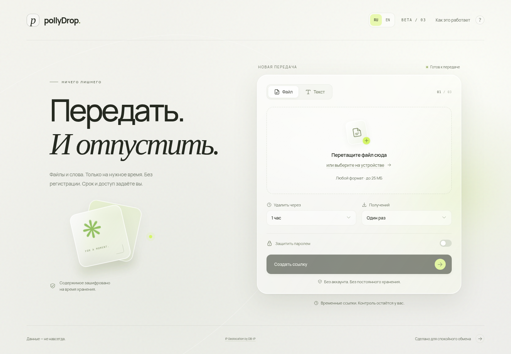

# pollyDrop

Временная передача файлов и текста без регистрации. Отправитель задаёт срок, лимит получений и пароль, затем делится ссылкой. Отдельная секретная ссылка позволяет проверить состояние и отозвать передачу.

**Текущая бета: v0.1.0-beta.2.** React + TypeScript, Java 21 + Spring Boot, PostgreSQL и Docker. Светлый адаптивный интерфейс с матовым стеклом, крупной типографикой и спокойными анимациями; настройка уменьшения движения учитывается.



[Интерфейс на телефоне](docs/images/mobile.png)

## Что работает

- Файл до 25 МиБ или текст до 64 КиБ, включая Unicode.
- Срок: 10 минут, 1 час, 24 часа или 2 дня.
- Лимит: 1, 3, 5 или 10 успешных отправок содержимого сервером.
- Пароль, отдельная ссылка управления и отзыв доступа.
- Атомарная резервация: только одна выдача данной передачи одновременно. Обнаруженный сервером обрыв освобождает резерв и позволяет повторить запрос.
- Шифрование содержимого AES-256-GCM; пароли Argon2id; в базе сохраняются хеши токенов.
- Удаление содержимого сразу после последнего получения или отзыва; удаление по таймеру истечения срока, повтор при временной ошибке раз в секунду. Восстановление резервов и таймеров после перезапуска.

Открытие страницы ссылки не расходует лимит. Сервер фиксирует завершение своей отправки, а не факт сохранения на устройстве. Если сервер успел отправить всё, последующий сбой браузера не возвращает использованное получение. Получатель может сохранить или переслать полученную копию.

Файлы передаются стандартному менеджеру загрузок браузера через HTTP-attachment, без скачивания в JavaScript Blob. Chrome сохраняет автоматически, если отключён запрос папки в `chrome://settings/downloads`. Встроенные браузеры мессенджеров могут ограничивать загрузку; в Telegram на iPhone доступно открытие ссылки в Safari.

После последнего получения содержимое удаляется из активного хранилища. При 10 минутах и 3 получениях удаление происходит по первому условию: истечение срока или завершение третьей выдачи. Подготовка загрузки, просмотр условий и HEAD не расходуют лимит. Старые передачи длиннее двух дней сокращаются миграцией до двух дней с момента создания.

## Быстрый запуск через Docker

Нужны Docker Engine с Compose, Bash и Python 3 для генерации локальных секретов.

```bash
git clone https://github.com/pollybich/pollyDrop.git
cd pollyDrop
./scripts/init-env.sh
docker compose up --build -d
```

Интерфейс доступен на порту **8088** вашего компьютера. По умолчанию порт привязан только к loopback. Порт PostgreSQL в Docker-установке наружу не публикуется. Для внешнего использования настройте домен, HTTPS и reverse proxy; не открывайте PostgreSQL наружу.

`.env` создаётся один раз с криптографически случайным ключом и паролем БД, исключён из Git и не входит в образы. Скрипт сохраняет существующий файл. Храните ключ вместе с резервной копией БД и содержимого: замена `APP_MASTER_KEY` делает уже созданные передачи нечитаемыми. Не отправляйте `.env` вместе с отчётом об ошибке.

```bash
docker compose logs backend
docker compose down
```

`down` сохраняет данные в volumes. Не используйте `down -v`, если хотите сохранить БД и содержимое.

## Обновление сервера Debian

```bash
cd /opt/pollydrop
git pull --ff-only
./deploy/server/update-debian.sh
```

Скрипт сохраняет существующий `.env` и volumes, скачивает опубликованные сборки с проверкой SHA-256, собирает образы и перезапускает сервисы. Caddy перечитывает конфигурацию с HTTP/1.1 и HTTP/2: HTTP/3 отключён, поскольку внешний UDP-порт 443 не опубликован. Подробнее — [инструкция сервера](deploy/server/README.md).

## Разработка

Нужны **полный JDK 21**, Node.js 24, Docker с Compose и Python 3. `JAVA_HOME` должен указывать на JDK, содержащий `javac`. Если Maven отсутствует, bootstrap скачивает Apache Maven 3.9.11 с проверкой SHA-512.

```bash
./scripts/bootstrap-dev.sh
./scripts/backend.sh
```

Во втором терминале:

```bash
npm --prefix frontend run dev
```

Vite использует порт 5173 и перенаправляет `/api` на backend:8080. Разработка использует отдельную БД `pollydrop-dev`, доступную только локально на порту 5432, и каталог `data/files`. Docker-установка использует свои volumes. Не смешивайте метаданные одной установки с содержимым другой. Бета допускает один backend на одну БД, что проверяется PostgreSQL advisory lock.

Проверки:

```bash
./scripts/backend.sh test
npm --prefix frontend run build
```

Интеграционные тесты поднимают отдельную PostgreSQL в Testcontainers. Временные ключи и тестовые данные отделены от рабочей БД. Для браузерных проверок см. [инструкцию](docs/TESTING.md).

## Границы беты

Аккаунтов, личного кабинета со списком передач, рекламы и корпоративного управления пока нет. Управление конкретной передачей работает через её секретную ссылку. Планы — в [ROADMAP](ROADMAP.md), полный реестр — в [требованиях](docs/REQUIREMENTS.md).

Шифрование выполняется на сервере и защищает хранение; это **не сквозное шифрование**. Метаданные передач остаются в БД после удаления содержимого. Копии в резервных бэкапах удаляются по политике администратора, а не этим сервисом. Ограничитель неверных паролей работает в памяти процесса, сбрасывается при перезапуске и считает адрес прямого HTTP-подключения; за proxy пользователи могут разделять этот адрес.

Бета рассчитана на один backend, локальное файловое хранилище с общей квотой 1 ГиБ и небольшую нагрузку. Это предварительный выпуск для проверки продукта: для открытого публичного сервиса ещё нужны защита от массовых загрузок, проверка безопасности и нагрузочные испытания. Настройки — [.env.example](.env.example), API и устройство — [архитектура](docs/ARCHITECTURE.md).
