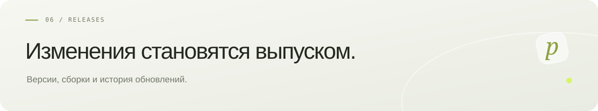

**Русский** · [English](en/RELEASING.md) · [← pollyDrop](../README.md)

# Выпуск обновлений

Каждое завершённое обновление pollyDrop публикуется отдельным GitHub Release: новая версия, новый тег, описание изменений, серверный JAR, статический frontend и SHA256SUMS. Несколько исправлений одного обновления объединяются в один выпуск. Опубликованные теги и сборки не перезаписываются. Исключение: прямое указание владельца публиковать конкретную правку в коде без новой версии и релиза. Тогда существующий выпуск сохраняется, а интерфейс на сервере обновляется явной командой `update-debian.sh --frontend-from-source`; обычное обновление устанавливает готовую сборку релиза.

1. Согласовать номер версии в Maven, frontend/lockfile, health, Dockerfile и скриптах установки/обновления сервера.
2. Добавить docs/releases/<tag>.md и обновить документацию изменившегося поведения.
3. Проверить сервер, frontend и браузерные сценарии. Для загрузок нужны Chromium и WebKit.
4. Создать тег на проверенном коммите и черновик релиза без вложений.
5. Запустить Publish beta release с этим тегом. Workflow проверяет, собирает и загружает вложения, затем публикует предварительный выпуск.
6. Проверить isDraft=false, успешный workflow и state=uploaded для всех assets; сообщить ссылку и команду обновления сервера.

Обновление приложения сохраняет исходный ключ и volumes; новую версию на собственном сервере применяет владелец либо исполнитель с предоставленным доступом.
