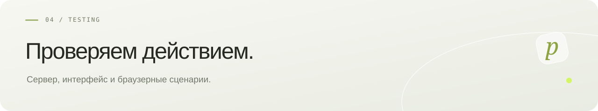

**Русский** · [English](en/TESTING.md) · [← pollyDrop](../README.md)

# Проверка v0.1.0-beta.3

## Сервер

```bash
python3 scripts/prepare-geoip.py
./scripts/backend.sh test
```

Нужен Docker: Testcontainers поднимает отдельную PostgreSQL 17.6. Семнадцать интеграционных тестов проверяют HTTP-сценарий текста, бинарные данные и имя файла, Argon2id и шифротекст, раздельные токены, ограничения пароля, обрыв потока, 100 одновременных запросов, отзыв/истечение/очистку, повреждение GCM, защиту от старого резерва, параметры и квоту, нативную загрузку, одноразовый ticket и безопасный HEAD, момент удаления после третьего получения, таймер без запросов к API и запрет хранения дольше двух дней. Это функциональные проверки; они не заменяют независимый аудит или нагрузочное тестирование.

## Интерфейс

```bash
npm --prefix frontend run build
```

Для браузерной проверки используйте Python 3 и Playwright 1.62.0 в отдельном окружении, установите Chromium штатным `playwright install chromium`. Если Chromium уже установлен, укажите путь в `CHROMIUM_PATH`. Запустите backend и Vite по README либо Docker-сборку.

```bash
BASE_URL=http://127.0.0.1:5173 python3 frontend/e2e/smoke.py
# Docker:
BASE_URL=http://127.0.0.1:8088 python3 frontend/e2e/smoke.py
```

Скрипт проверяет отсутствие горизонтальной прокрутки на ширинах 320, 375, 390, 768, 1024, 1440; диалог и Escape; пароль и UTF-8 текст; отображение разметки как текста; исчерпание одноразовой ссылки; загрузку реального бинарного файла; управление и отзыв; неизвестный токен, пустой файл и reduced motion. Скриншоты пустой формы сохраняются в игнорируемый `test-results/screenshots`; секретные ссылки в вывод не попадают.

После тестов на рабочей установке остаются метаданные тестовых передач, а доступное содержимое живёт до своего TTL. Используйте отдельную тестовую установку; не запускайте сценарий на production без намерения создать эти передачи.

## Docker

```bash
./scripts/init-env.sh
docker compose build
docker compose up -d
curl --fail http://127.0.0.1:8088/api/health
```

За корпоративным или облачным HTTPS-proxy сборке могут понадобиться дополнительные доверенные CA и настройки Maven. Dockerfiles поддерживают необязательные BuildKit secrets `maven_settings`, `java_truststore` и `environment_ca`; передавайте их через локальный Compose override, исключённый из Git. HTTPS_PROXY/HTTP_PROXY передаются штатными build args. Проверка сертификатов остаётся включённой; файлы настроек не сохраняются в образе. Настройки конкретной облачной среды не входят в релиз.

GitHub Actions дополнительно запускает браузерные проверки в Chromium и WebKit с эмуляцией iPhone. Они воспроизводят оборванные запросы метаданных и проверяют, что ошибка обновления состояния не скрывает уже полученные данные. Это проверка браузерных движков; физический iPhone внутри Telegram отдельно не эмулируется.

```bash
BASE_URL=http://127.0.0.1:8088 python3 frontend/e2e/languages.py
```
