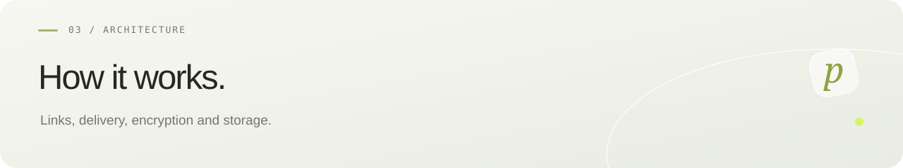

[Русский](../ARCHITECTURE.md) · **English** · [← pollyDrop](README.md)

# Beta architecture

Browser → Nginx → Spring Boot → PostgreSQL (metadata) + encrypted local files. Vite is the development proxy. One backend holds a dedicated PostgreSQL advisory lock; a second instance is rejected. Losing the lock connection makes the backend unready until restart. Multiple replicas are not supported.

## Transfers and secrets

`POST /api/transfers` accepts multipart `options` JSON and an optional `file` part:

```json
{"kind":"TEXT","text":"Hello","ttlSeconds":3600,"maxDownloads":1}
```

For files use `kind: FILE`. Optional passwords are at most 128 characters. TTL is 600–172800 seconds; the download limit is 1–10. The current form defaults to one hour.

The 201 response includes `readToken`, `manageToken` and `transfer`. Both tokens contain 32 random bytes encoded as 43 base64url characters; the database stores their SHA-256 hashes. Recipient `/s/{readToken}` and management `/manage/{manageToken}` links are independent secrets. Protected filenames remain hidden before authorization.

Nginx disables URL access/error logs. Fonts are local; no third-party analytics or ad scripts. Metadata and management responses use `Cache-Control: no-store`.

| Endpoint | Behavior |
| --- | --- |
| `GET /api/health` | Readiness and version. |
| `GET /api/transfers/{token}` | Public conditions and state, without content. |
| `POST /api/transfers/{token}/download` | Explicit binary/text delivery; body `{}` or a password object. |
| `POST /api/transfers/{token}/download-ticket` | Authorize without spending a download; return relative download/status URLs. |
| `GET /api/downloads/{secret}` | Native file attachment; single-use 256-bit ticket valid for 60 seconds, hashed in memory. Recheck limits at actual delivery. No password in the URL. |
| `GET /api/downloads/{secret}/status` | READY/SENDING/SENT/FAILED/EXPIRED for this delivery. No content or download consumption. |
| `GET /api/manage/{token}` | Sender’s transfer status. |
| `DELETE /api/manage/{token}` | Revoke access; 204. |

Prepared tickets are retained at most five minutes; completed status for two more minutes. Active deliveries remain until completion; memory is capped at 1024 tickets. HEAD on real downloads is rejected before claiming the ticket.

Errors: 400 parameters, 401 password, 404 unknown link, 409 active delivery, 410 access ended, 413 size, 429 password attempts, 507 quota. No cross-origin API access is enabled.

## Delivery and interruption

A transaction locks the transfer row, checks all conditions and records a unique reservation. Delivery happens outside that transaction. GCM integrity is verified before the first plaintext byte. Each 64 KiB block checks expiry, revocation and reservation ownership. A separate transaction releases the reservation and increments the count only after the complete send and flush. An IOException frees the slot without consuming a download. Reservation IDs fence old streams from completing a newer reservation.

Retries are possible after a server-detected interruption. A completed server send does not prove a saved file; received bytes cannot be recalled. Text uses a Blob in the browser; files use native downloads. Server-side GCM verification loads a bounded file into memory; files are capped at 25 MiB. Multiuser load testing remains planned.

At startup the single backend releases old reservations, removes orphaned files, cleans unavailable content and restores expiry timers. The final delivery or revocation deletes content after transaction commit and before request handling completes. Expiry also deletes during an active delivery; the next block check stops its stream. One-second fallback cleanup retries failed deletions. Metadata remains for management. Timer accuracy depends on a running process and available storage; startup removes expired files before API readiness.

## Storage

File format: version byte 1 + random 12-byte nonce + AES-256-GCM ciphertext/tag, with the UUID as AAD. Temporary writes move atomically; failed creation transactions remove their content file. Argon2id uses 64 MiB, three iterations, parallelism 1 and a 16-byte salt. Five bad passwords per transfer/direct-connection address trigger a 15-minute in-memory lockout.

Keys live separately in `.env`. Public access requires HTTPS at the external proxy. Key rotation, antivirus, scaling, backups and automatic metadata retention are future work.
