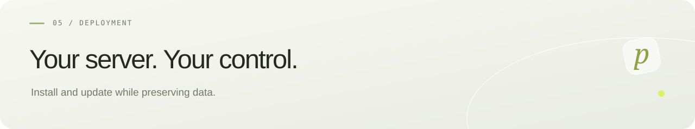

[Русский](../../deploy/server/README.md) · **English** · [← pollyDrop](README.md)

# Debian 13 deployment

Domain: `drop.pollybich.ru`. Requires an existing Docker installation and free TCP ports 80, 443 and 8088. Run as root on your own server; no SSH passwords or keys need to be shared.

```bash
apt-get update && apt-get install -y git
git clone https://github.com/pollybich/pollyDrop.git /opt/pollydrop
cd /opt/pollydrop
./deploy/server/install-debian.sh
```

If the directory exists, inspect it first; cloning will not overwrite it. The installer downloads an official Compose release if needed and verifies SHA-256, then downloads verified pollyDrop v0.1.0-beta.2 assets. The backend uses the released JAR; Docker compiles the current checkout’s frontend. No host Java/Node compiler is required. It creates `.env` locally only once. Generated assets live in ignored `.runtime/server`.

The `pollydrop-public` project runs PostgreSQL, backend, frontend and Caddy. Caddy serves HTTP/1.1 and HTTP/2, obtains/renews HTTPS certificates and preserves them in volumes. Ports 80/443 must be externally reachable. PostgreSQL/backend are private; port 8088 is loopback-only. Containers restart automatically with bounded logs. Preserve volumes and the original encryption key.

Production Nginx limits creation to 12 transfers/minute with a small burst and caps in-flight creation/delivery requests at two. Overload returns 429 with a suggested one-minute retry. These are initial beta limits, not comprehensive abuse protection. Proxy URL logs are disabled to protect link tokens.

## Verify and troubleshoot

```bash
curl --fail --retry 6 --retry-all-errors --retry-delay 5 --max-time 15 https://drop.pollybich.ru/api/health
```

Expect `status: ok` and `version: 0.1.0-beta.2`, then test a transfer. Inspect errors:

```bash
cd /opt/pollydrop
docker compose -p pollydrop-public -f compose.yaml -f deploy/server/compose.server.yaml logs --tail=50 caddy backend
```

Stop while keeping data:

```bash
docker compose -p pollydrop-public -f compose.yaml -f deploy/server/compose.server.yaml down
```

Do not add `-v`. Restore needs the database, content and original `APP_MASTER_KEY` together. Automatic backups are not configured. If another proxy already owns ports 80/443, adapt the supplied Nginx templates or Caddy fragment and Compose instead of launching a second public proxy.

## Server update

```bash
cd /opt/pollydrop
git pull --ff-only
./deploy/server/update-debian.sh
```

Secrets and volumes remain. Migration also limits existing transfers to two days from creation. Active content is deleted on the final download or expiry, whichever comes first. Backups and metadata have separate lifecycles.

## Current interface by default

Installation and normal updates compile the checkout’s frontend with Node.js 24, locked dependencies and production Nginx before restarting services. No host Node.js is needed. The backend remains the verified published build. The one-hour default therefore requires only the normal update command above.

Keys, database, files, HTTPS and request limits are preserved. Health stays version `0.1.0-beta.2`; reload the page after updating and check that a fresh form shows one hour.

`--frontend-from-source` remains compatible. Use `--frontend-from-release` only to explicitly install the published frontend; the old release defaults to 24 hours.
