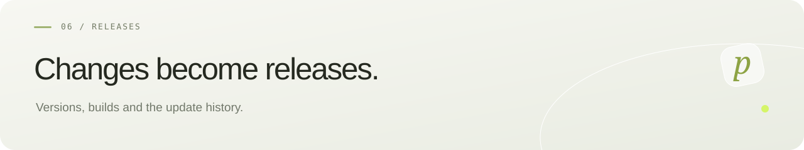

[Русский](../RELEASING.md) · **English** · [← pollyDrop](README.md)

# Releasing updates

Each completed update gets a new GitHub Release with a new version/tag, notes, server JAR, frontend archive and SHA256SUMS. Group related fixes into one update. Never overwrite a published tag or asset.

Exception: the owner explicitly requests a source-only change without a new version/release. Keep the existing release intact and use normal `update-debian.sh` updates, which compile the current frontend checkout.

1. Synchronize Maven/frontend versions, lockfile, health response, Docker JAR path and server scripts.
2. Add `docs/releases/<tag>.md` and update behavior documentation.
3. Check backend, frontend and browser flows; download changes require Chromium and WebKit.
4. Tag the verified commit and create a draft release without assets.
5. Run “Publish beta release” for the tag. It tests, builds, uploads assets and publishes the prerelease.
6. Confirm `isDraft=false`, successful workflow and uploaded assets, then share the release URL and server-update command.

Server updates preserve the original key and volumes and are applied by the owner or an authorized operator with access. Never publish private financial planning, real names, credentials or private server access details.
