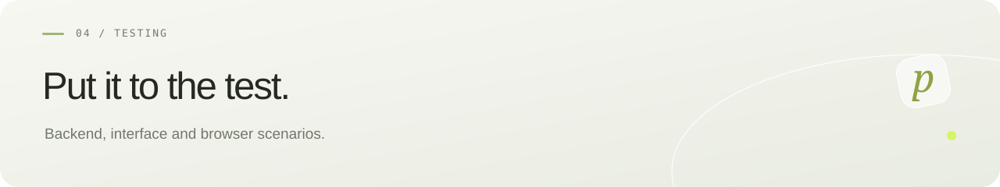

[Русский](../TESTING.md) · **English** · [← pollyDrop](README.md)

# Checking v0.1.0-beta.2

## Backend

```bash
./scripts/backend.sh test
```

Requires Docker; Testcontainers creates a separate PostgreSQL 17.6 instance. Fifteen integration tests cover text/binary HTTP flows, filenames, password hashing, ciphertext, token separation, password limits, interrupted streams, 100 concurrent requests, revocation/expiry/deletion, damaged GCM, stale reservations, parameters/quota, native downloads, single-use tickets, safe HEAD requests, deletion after the third delivery, timers without API requests and the two-day retention cap. Functional checks do not replace a security review or load test.

## Frontend

```bash
npm --prefix frontend run build
```

Browser checks require Python 3 and Playwright 1.62.0. Install Chromium using `playwright install chromium`, or set `CHROMIUM_PATH` for an existing installation. Start the backend and Vite as described in the README, or run the Docker app.

```bash
BASE_URL=http://127.0.0.1:5173 python3 frontend/e2e/smoke.py
# Docker:
BASE_URL=http://127.0.0.1:8088 python3 frontend/e2e/smoke.py
```

The script covers widths 320, 375, 390, 768, 1024 and 1440, dialogs/Escape, passwords/UTF-8, escaped markup, one-time exhaustion, real binary downloads, management/revocation, unknown tokens, empty files and reduced motion. Empty-form screenshots go to ignored `test-results/screenshots`; secret links are not printed.

Checks create transfer metadata and temporary content. Use a separate test installation; do not run against production unless these writes are intentional.

## Docker

```bash
./scripts/init-env.sh
docker compose build
docker compose up -d
curl --fail http://127.0.0.1:8088/api/health
```

Behind HTTPS proxies, builds may need trusted CAs or Maven settings. Dockerfiles support optional BuildKit secrets `maven_settings`, `java_truststore` and `environment_ca`; pass them through a local ignored override. Standard HTTP_PROXY/HTTPS_PROXY build arguments are supported. TLS checks stay enabled and secret files are not stored in images.

GitHub Actions runs Chromium and WebKit with iPhone emulation, including dropped metadata requests and failed background refreshes. This checks browser engines, not a physical iPhone inside Telegram.
